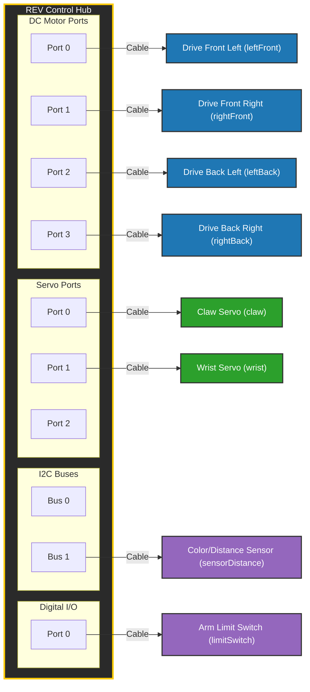

# 🤖 Robot Hardware Port Map

This document serves as the visual master configuration for our robot. When adding or changing physical cables, update this chart and verify that the names match the configuration on the Driver Station phone/Control Hub precisely.

## 📋 Hardware Details Table

| Hub Unit | Port Type | Port # | Device Name in Code | Physical Hardware Component | Notes / Target Subsystem |
| :--- | :--- | :--- | :--- | :--- | :--- |
| Control Hub | Motor | 0 | `"leftFront"` | GoBILDA 5203 (19.2:1) | Mecanum Drivetrain |
| Control Hub | Motor | 1 | `"rightFront"` | GoBILDA 5203 (19.2:1) | Mecanum Drivetrain |
| Control Hub | Motor | 2 | `"leftBack"` | GoBILDA 5203 (19.2:1) | Mecanum Drivetrain |
| Control Hub | Motor | 3 | `"rightBack"` | GoBILDA 5203 (19.2:1) | Mecanum Drivetrain |
| Control Hub | Servo | 0 | `"claw"` | REV Smart Servo | Intake Mechanism |
| Control Hub | Servo | 1 | `"wrist"` | GoBILDA Torque Servo | Intake Articulation |
| Control Hub | I2C | 1 | `"sensorDistance"`| REV Color Sensor V3 | Autonomous Navigation |
| Control Hub | Digital | 0 | `"limitSwitch"` | REV Touch Sensor | Lift Safety Boundary |
